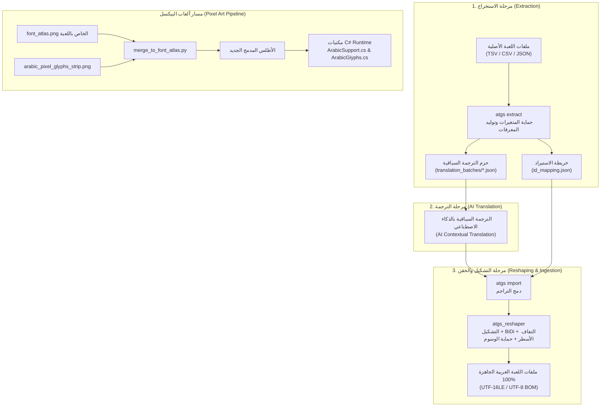

<div align="center">

# 🎮 ATGS: Arabic Translate Game Skill
### المجموعة الشاملة لتعريب وتوطين ألعاب الفيديو للغة العربية
**Universal Arabic Game Localization Suite & Pixel Art Font Engine**

[](https://opensource.org/licenses/MIT)
[](https://www.python.org/)
[](https://unity.com/)
[](#-pixel-art-toolkit)
[](#-الميزات-الرئيسية)

[English Summary](#english-overview) • [الميزات الرئيسية](#-الميزات-الرئيسية) • [دليل التثبيت](#-دليل-التثبيت) • [أوامر الاستخدام](#-أوامر-الاستخدام-السريع-cli) • [حلول Unity](#-حلول-محركات-unity) • [دراسة حالة DSP](#-دراسة-حالة-dyson-sphere-program)

</div>

---

## 📖 مقدمة عن المشروع (About ATGS)

مشروع **ATGS (Arabic Translate Game Skill)** هو حزمة هندسية ومكتبة برمجية متكاملة مصممة خصيصاً للتغلب على كافة العقبات التقنية التي تواجه تعريب وتوطين ألعاب الفيديو إلى اللغة العربية، سواء في ألعاب المحركات الحديثة (مثل **Unity**, **Godot**, **Unreal**) أو ألعاب البيكسل والريترو الثنائية الأبعاد (**Pixel Art / 2D Indie Games**).

يقدم هذا النظام حلاً جذرياً لمشاكل انفصال الحروف، وانعكاس النصوص (BiDi)، وتداخل حركات التشكيل، وانقلاب وسوم التنسيق الغني (`<color>`, `<b>`)، وانقلاب الأسطر المتعددة في المحركات التي تقرأ من اليسار لليمين فقط (LTR).

---

## ✨ الميزات الرئيسية (Key Features)

- 🔍 **Universal Game String Extractor**:
  استخراج تلقائي لنصوص الألعاب من مختلف التنسيقات (TSV, CSV, JSON, Heaps, PO, Flat Text) مع الحفاظ التام على المفاتيح والمعرفات الأصلية.
- 🤖 **AI Translation Batch Preparation**:
  تجزئة النصوص إلى حزم منظمة متوازنة ومزودة بالسياق الوظيفي والمكاني لكل نص لتسهيل الترجمة بواسطة نماذج الذكاء الاصطناعي بدقة عالية.
- 🛡️ **Tag-Safe & Variable-Safe Reshaping**:
  حماية متقدمة لوسوم المحركات (`<color=#HEX>`, `<b>`, `<i>`, `<size>`, `<quad>`) والأكواد البرمجية (`{0}`, `%s`, `$var;`) بحيث تظل في مواضعها البصرية السليمة دون أي تلف أو تشوه.
- 📐 **Tag-Safe Multiline Word-Wrapping**:
  حل هندسي مبتكر لمشكلة انقلاب ترتيب الأسطر في صناديق نصوص Unity uGUI؛ حيث يتم التفاف الأسطر منطقياً قبل التشكيل والعكس ليقرأ اللاعب النص من الأعلى للأسفل ومن اليمين لليسار بسلاسة.
- 🎨 **1:1 Pixel Art Arabic Font Engine**:
  شريط خط عربي بيكسلي نقي بدقة 1:1 مستوحى من خطوط Minecraft العربية، مع أداة دمج تلقائية في أطلس خطوط اللعبة (`Font Atlas`) ومكتبات C# جاهزة للرسم اللحظي.
- 🔄 **Lossless Game Rebuilder**:
  إعادة بناء وحقن ملفات اللعبة بأدق الترميزات المطلوبة للمحرك (مثل `UTF-16LE` لجداول Unity أو `UTF-8 with BOM` للشروحات).

---

## 🏗️ مخطط معمارية النظام (Architecture Pipeline)



---

## 🚀 دليل التثبيت (Installation)

### المتطلبات الأساسية
- **Python 3.8+**
- تثبيت الحزم المطلوبة:
```bash
pip install -r requirements.txt
```

*(تتضمن المتطلبات: `arabic-reshaper`, `python-bidi`, `Pillow`)*

---

## 💻 أوامر الاستخدام السريع (CLI Usage)

يوفر **ATGS** واجهة سطر أوامر موحدة `atgs_cli.py`:

### 1. استخراج النصوص وتجهيز الحزم
```bash
python scripts/atgs_cli.py extract "<مسار_مجلد_اللعبة>" -o "./atgs_batches" -b 150
```
- يقوم بمسح ملفات التوطين، واكتشاف المتغيرات والوسوم، وإنشاء حزم الترجمة `batch_001.json`, `batch_002.json` وخريطة الربط `id_mapping.json`.

### 2. تشكيل وعكس النصوص العربية لمحركات LTR
```bash
# معالجة نص مفرد في الطرفية
python scripts/atgs_cli.py reshape "مستوى الطاقة الحالي: <color=#FFFF00>{0}%</color> (ممتاز)" -w 50

# معالجة ملف ترجمة JSON كامل
python scripts/atgs_cli.py reshape -i "translations.json" -o "translations_shaped.json" -w 55
```

### 3. استيراد الترجمات وإعادة بناء ملفات اللعبة
```bash
python scripts/atgs_cli.py import "./atgs_batches/translation_batches" "./atgs_batches/import_mapping/id_mapping.json" -o "<مسار_حفظ_ملفات_اللعبة>" --encoding utf-16le
```

### 4. دمج خط البيكسل العربي في أطلس خطوط اللعبة
```bash
python scripts/atgs_cli.py pixel-merge "path/to/game_font.png" -o "path/to/merged_font.png" --v-offset 210
```

---

## 🕹️ حلول محركات Unity (Unity Solutions)

عند تعريب ألعاب Unity التي تستخدم واجهة المستخدم الكلاسيكية (`UnityEngine.UI.Text`):
1. **أشكال اليونيكود (Presentation Forms-B)**:
   يتم تحويل الأحرف إلى شفرات اليونيكود الصريحة من `U+FE70` إلى `U+FEFF` المدعومة أصلياً في خطوط النظام المضمنة دون الحاجة لخطوط مخصصة.
2. **تجريد حركات التشكيل (Diacritic Stripping)**:
   حذف حركات الإعراب المتراكبة آلياً لتفادي الفجوات البصرية بين الحروف في خط uGUI.
3. **التفاف الأسطر المتعددة الآمن (Multiline Pre-Wrapping)**:
   تقسيم الجمل الطويلة عند حدود الكلمات قبل عكسها، مما يمنع انقلاب ترتيب الأسطر من أسفل لأعلى.

لمزيد من التفاصيل، راجع: [دليل حلول Unity](./docs/UNITY_UGUI_SOLUTIONS.md).

---

## 👾 حزمة ألعاب البيكسل (Pixel Art Toolkit)

تتضمن الحزمة أصولاً برمجية وبصرية كاملة لألعاب البيكسل والريترو:
- `pixel_toolkit/arabic_pixel_glyphs_strip.png`: شريط جليف متصل متوافق بنسبة 1:1 مع الشبكة النقطية.
- `csharp/ArabicSupport.cs`: محرك C# لمعالجة النصوص وتشكيلها وعكسها لحظياً أثناء تشغيل اللعبة.
- `csharp/ArabicGlyphs.cs`: مصفوفة دقيقة لإحداثيات كل حرف وعرض التقدم (`advance width`) لضمان عدم وجود فجوات.
- `csharp/UniversalTextRendererExample.cs`: نموذج تطبيقي لرسم الحروف في أي محرك (Unity, MonoGame, Godot, Raylib).

لمزيد من التفاصيل، راجع: [دليل تعريب ألعاب البيكسل](./docs/PIXEL_GAMES_GUIDE.md).

---

## 🏆 دراسة حالة: Dyson Sphere Program

تم تطبيق واختبار خط أنابيب **ATGS** بالكامل على لعبة **Dyson Sphere Program** (Build 23109513، محرك Unity 2022 Mono):
- ✅ استخراج وتعريب **6,164 سجلاً** عبر 9 ملفات TSV بتنسيق UTF-16LE.
- ✅ تعريب **22 درساً تعليمياً كاملاً** في نظام الـ Wiki و **24 سجل تحديث**.
- ✅ حل مشكلة ظهور اللغة في قائمة اللغات عبر ضبط حقول `Locale/Header.txt` ومفتاح ريجستري الويندوز.
- ✅ معالجة الحروف المعكوسة والمنفصلة والتفاف الأسطر التلقائي.

لمزيد من التفاصيل، راجع: [دراسة حالة Dyson Sphere Program](./docs/CASE_STUDY_DYSON_SPHERE_PROGRAM.md).

---

## 🌐 English Overview

**ATGS (Arabic Translate Game Skill)** is a comprehensive, production-grade toolkit engineered to solve the complex technical challenges of Arabic game localization:
- **BiDi & Shaping for LTR Engines**: Transparently converts Arabic text into Unicode Presentation Forms-B and computes correct visual LTR ordering for engines lacking native RTL support (such as Legacy Unity uGUI).
- **Tag-Safe & Placeholder-Safe Engine**: Protects variables (`{0}`, `%s`) and rich text tags (`<color>`, `<b>`) while preserving correct nesting and display order.
- **Tag-Safe Multiline Wrapping**: Solves the common reverse line-wrap defect in game text boxes by logically segmenting words before reshaping.
- **1:1 Pixel Art Engine**: Includes a pixel-perfect Arabic font strip, automated atlas merging, and runtime C# scripts for retro/2D indie games.

---

## 📄 الترخيص (License)

هذا المشروع مرخص بموجب رخصة [MIT License](./LICENSE). حر ومفتوح المصدر لجميع مطوري ومترجمي ألعاب الفيديو في العالم العربي.
