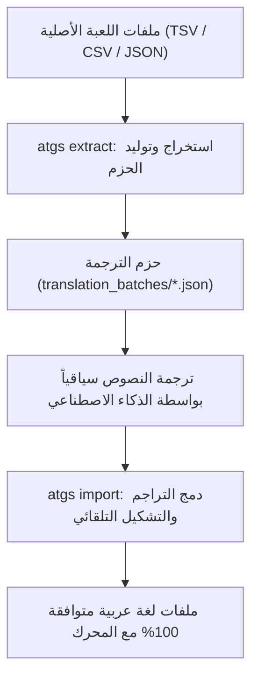

# الدليل الشامل لتعريب ألعاب الفيديو (Universal Game Localization Guide)

مرحباً بك في الدليل المرجعي لمشروع **ATGS** (Arabic Translate Game Skill). يغطي هذا الدليل الأسس الهندسية والتقنية لتوطين ألعاب الفيديو للغة العربية، وكيفية التغلب على قيود المحركات الغربية.

---

## 1. التحديات التقنية للغة العربية في محركات الألعاب

تختلف اللغة العربية عن اللغات اللاتينية في ثلاث خصائص جوهرية:

1. **طبيعة الحروف المتصلة (Cursive Shaping)**:
   - الحرف العربي يتغير شكله بحسب موقعه في الكلمة (منفصل، بداية، وسط، نهاية).
   - المحركات التي لا تحتوي على مكتبات تشكيل متقدمة (مثل HarfBuzz أو FriBidi أو TextMeshPro مع دعم RTL) تعرض الحروف منفصلة بأشكالها المعزولة (مثل: `م ر ح ب ا`).

2. **اتجاه الكتابة من اليمين إلى اليسار (Bi-directional / RTL)**:
   - تُكتب النصوص العربية من اليمين إلى اليسار، ولكن عند وجود أرقام أو كلمات أجنبية يجب أن تُقرأ الأرقام من اليسار إلى اليمين داخل السياق العربي.
   - إذا كان المحرك يدعم العرض من اليسار لليمين فقط (LTR)، فإن النصوص العربية ستظهر معكوسة الترتيب (مثل: `ابحرم`).

3. **حركات الإعراب والأقواس وعلامات الترقيم (Diacritics & Mirroring)**:
   - حركات التشكيل (الفتحة، الضمة، الكسرة، التنوين) هي أحرف متراكبة (Combining Characters). عند عكس النصوص بدون معالجة خاصة، تنفصل هذه الحركات وتخلق فراغات مشوهة في الخطوط.
   - الأقواس `(` و `)` وعلامات التنصيص تتطلب عكساً بصرياً (Punctuation Mirroring) لتطابق الاتجاه العربي.

---

## 2. استراتيجيات التعريب: محلي (Static Shaping) مقابل فوري (Runtime Shaping)

### الاستراتيجية الأولى: التشكيل الثابت المسبق (Static Pre-Shaping)
- **متى تستخدمها؟**
  - عندما تكون اللعبة مغلقة المصدر ولا ترغب في حقن مكتبات برمجية ثنائية (Binary DLLs).
  - في ألعاب محرك Unity التي تستخدم واجهات `UnityEngine.UI.Text` (Legacy uGUI) حيث يمكن وضع نصوص جاهزة في ملفات الـ Assets أو نصوص الترجمة.
- **كيف تعمل؟**
  - يتم استبدال الحروف العربية بروابط أشكال اليونيكود الصريحة:
    - **Arabic Presentation Forms-B** (`U+FE70` إلى `U+FEFF`).
    - **Arabic Presentation Forms-A** (`U+FB50` إلى `U+FDFF`).
  - يتم حساب الترتيب البصري LTR وعكس الكلمات العربية، مع حماية المتغيرات والأقواس.
  - النتيجة: يقرأ المحرك السلسلة كنص LTR عادي، لكنه يظهر على الشاشة كعربية سليمة متصلة من اليمين لليسار!

### الاستراتيجية الثانية: التشكيل اللحظي (Runtime Shaping via C#/C++)
- **متى تستخدمها؟**
  - في ألعاب البيكسل أو المحركات المفتوحة أو عند بناء Mod للعبة.
  - عند الحاجة لرسم نصوص ديناميكية تتغير في كل إطار (Frame).
- **المكتبات الجاهزة في ATGS**:
  - `csharp/ArabicSupport.cs`: توفر دالة `ProcessLine(string text)` لتشكيل وعكس النصوص برمجياً أثناء التشغيل.
  - `csharp/ArabicGlyphs.cs`: توفر مصفوفة إحداثيات ومسافات الحروف البيكسلية لضمان عدم وجود فجوات.

---

## 3. حماية المتغيرات ووسوم التنسيق (Rich Text Tags & Placeholders)

في معظم الألعاب، تحتوي النصوص على:
- **متغيرات برمجية**: مثل `{0}`, `{1}`, `{$count}`, `$LKEY_01;`, `%s`, `%d`.
- **وسوم تنسيق**: مثل `<color=#FF0000>نص</color>`, `<b>نص</b>`, `<size=18>نص</size>`.

### المشكلة:
إذا قمت بعكس النص كاملاً:
- الوسم `<color=#FFF>` سيتحول إلى `>FFF#=color<`، مما يتسبب في فشل تفسير الوسم وظهوره كنص مشوه على الشاشة.
- المتغير `{0}` قد ينقلب إلى `{0}` في مواضع غير صحيحة أو يفقد تسلسله.

### حل ATGS:
يستخدم محرك `atgs_reshaper.py` آلية "الرموز المحمية البديلة (Token Placeholders)"، حيث يتم:
1. استخراج كل الوسوم والمتغيرات واستبدالها بمعرفات لاتينية آمنة ومؤقتة.
2. تشكيل وعكس النصوص العربية فقط.
3. استعادة الوسوم والمتغيرات في مواضعها البصرية الصحيحة مع الحفاظ على ترتيب وسوم البداية والنهاية.

---

## 4. مشكلة التفاف الأسطر المتعددة (Multiline Word-Wrapping)

في محركات الألعاب الغربية، عندما يتجاوز النص عرض صندوق العرض (Text Box)، يقوم المحرك بتقسيم النص من اليسار إلى اليمين.
- إذا عكست نصاً طويلاً مكوناً من 3 أسطر دفعة واحدة، فإن السطر الأخير سينتهي به الأمر في أعلى الصندوق، والسطر الأول في أسفله!
- **الحل في ATGS**:
  - تفعيل خيار `wrap_text_tag_safe(text, max_chars=55)`.
  - تقوم الأداة بتقسيم النص منطقياً إلى أسطر حسب عرض الكلمات دون كسر الوسوم، ثم تشكيل وعكس كل سطر على حدة.
  - النتيجة: تظهر الفقرة منسقة من اليمين لليسار، وتقرأ من الأعلى للأسفل بشكل طبيعي تماماً.

---

## 5. خطوات دورة عمل التعريب بواسطة ATGS

